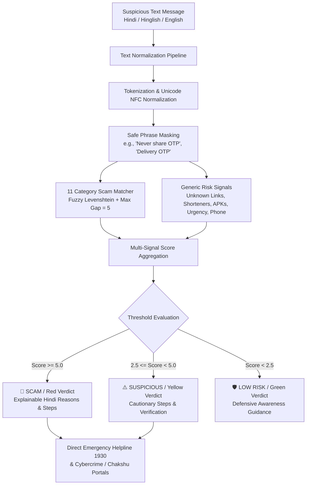

# Scam Saathi (स्कैम साथी) — System Architecture

> **Hack for Social Cause 2027**  
> **Theme:** Digital Safety & Cyber Fraud Awareness  
> **Knowledge Partner:** IIT Bombay  

---

## 1. System Overview

**Scam Saathi** is a privacy-first, on-device cyber fraud detection engine and web application. It allows first-time smartphone users and vulnerable citizens in rural/semi-urban India (specifically Uttar Pradesh) to evaluate suspicious text messages (SMS, WhatsApp forwards, links) in Hindi, Hinglish, and English without requiring any backend server, AI API key, or data transmission over the internet.

---

## 2. Detection Pipeline Details

### Step 1: Unicode Normalization & Cleaning
- **NFC normalization** removes zero-width characters and invisible phishing obfuscation.
- **Devanagari Normalization:** Strips nukta (`़`), standardizes chandrabindu (`ँ` $\to$ `ं`), maps Devanagari numerals (`०-९`) to ASCII `0-9`.
- **Digit Grouping:** Strips commas within amounts (e.g., `10,000` $\to$ `10000`) to prevent token fragmentation.
- **Punctuation & Contractions:** Converts `don't` $\to$ `dont`, expands repeated characters (`bhejooo` $\to$ `bhejoo`), condenses dotted abbreviations (`o.t.p` $\to$ `otp`).

### Step 2: Safe Phrase Blanking (False-Positive Prevention)
Genuine messages from banks or delivery apps often contain the word "OTP" (e.g., *"Your OTP is 4829. Never share it with anyone."* or *"Share OTP only with delivery partner."*).
- Safe phrases in English, Hinglish, and Devanagari are matched and their tokens replaced with `_` **before** scam phrase matching occurs.
- This ensures genuine transaction alerts and delivery SMS are not falsely flagged.

### Step 3: Multi-Word Phrase Matching with Fuzzy Tolerances
Scam patterns are structured across 11 distinct categories:
1. **OTP Request** (`otp_request`)
2. **Private Info Request** (`info_request`)
3. **SIM / KYC Threat** (`sim_kyc`)
4. **Bank Account / Card Threat** (`bank_threat`)
5. **UPI / Reverse Transfer / QR Scam** (`upi_refund`)
6. **Govt Schemes & Subsidies** (`govt_scheme`)
7. **Lottery / Prize Fraud** (`lottery`)
8. **Work From Home / Job Scam** (`job_offer`)
9. **Instant Fake Loan** (`loan`)
10. **Electricity Disconnection Threat** (`electricity`)
11. **Digital Arrest / CBI / Police Fraud** (`authority_threat`)

- **Word Gap Allowance (`MAX_GAP = 5`):** Matches scam keywords even when intervening words (amounts, app names, dates) appear (e.g., *"galti se [aapke Paytm mein 10000 rupaye] transfer ho gaye"*).
- **Levenshtein Fuzzy Matching:** Roman words of 5+ letters permit typos (e.g., `updte` $\to$ `update`, `blok` $\to$ `block`), preventing deliberate evasion.

### Step 4: Generic Risk Signals
- **Domain Lookalike Detection:** Inspects URLs against trusted Indian domains (`gov.in`, `nic.in`, `uppcl.org`, `sbi.co.in`, `amazon.in`, etc.). Untrusted links with brand words (`sbi`, `kyc`, `discom`, `aadhaar`) receive lookalike penalties (+5 pts).
- **Link Shorteners (+4 pts):** Flags `bit.ly`, `tinyurl.com`, `is.gd`, etc.
- **Android APK Download (+4 pts):** Flags `.apk` attachments or download invitations.
- **Urgency Signals (+1.5 pts):** Detects time pressure words (*"tonight"*, *"आज रात"*, *"24 ghante"*, *"warna"*).
- **Unsolicited Phone (+1 pt):** Detects 10-digit Indian mobile numbers.

### Step 5: Explainability & Actionable Output
Rather than opaque AI responses, Scam Saathi produces deterministic, human-vetted Hindi guidance:
- Clear headline and risk color
- Concrete reasons (why it was flagged)
- Exact next steps (what not to click, branch verification)
- Immediate click-to-call link for **National Cyber Crime Helpline 1930** and links to **Sanchar Saathi (Chakshu)** and **cybercrime.gov.in**.

---

## 3. Threat Model & Privacy Guarantees

| Concern | Scam Saathi Architecture |
|---|---|
| **Data Leakage** | 100% Zero-Network Execution. Code runs purely in the client browser. No messages, phone numbers, or tokens ever leave the user's handset. |
| **Hallucination** | No generative model is used. Every output string is pre-vetted by cyber safety guidelines. |
| **Downtime / Latency** | Instant (< 5ms) offline execution. Works in rural areas with zero internet connectivity once loaded. |
| **Operational Cost** | ₹0 recurring server / API costs. Static file hosting on GitHub Pages / Vercel. |

---

## 4. Test Suite & Validation

The project maintains two test suites validated on every build:
- **`tests/testset.json` (30 baseline cases):** 30/30 exact verdict match (100%).
- **`tests/unseen-testset.json` (24 real-world unseen cases):** 24/24 exact verdict match (100%).
- **Combined Accuracy:** 54/54 (100% exact verdict match, 0% scams missed as low risk, 0% genuine messages flagged).
