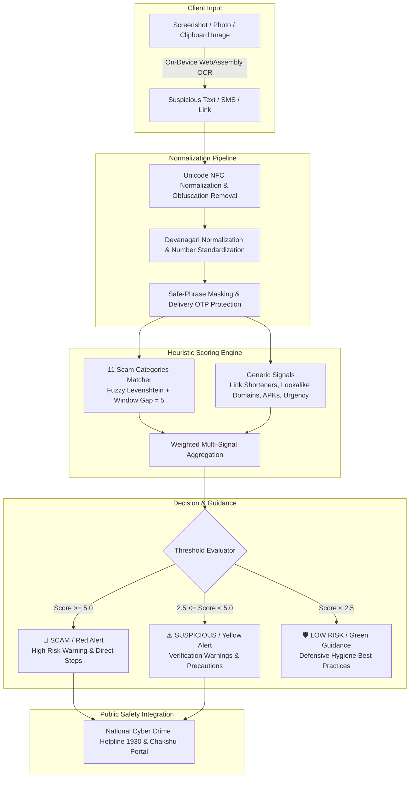

# Scam Saathi (स्कैम साथी / স্ক্যাম সাথী)
### On-Device Trilingual Cyber Scam Detection & Citizen Safety Engine

[](LICENSE)
[-success.svg)](tests/run-tests.js)
[](https://mybharat.gov.in/pages/hack-for-social-cause)
[](https://www.iitb.ac.in)

> **Submission for Hack for Social Cause 2027**  
> **Theme:** Digital Safety & Cyber Fraud Awareness  
> **Knowledge Partner:** IIT Bombay | **Platform:** MY Bharat (Ministry of Youth Affairs & Sports)

---

## Executive Summary

**Scam Saathi** is an open-source, 100% client-side digital safety application engineered to protect first-time smartphone users, rural communities, and vulnerable citizens across India against cyber fraud. 

In India, rapid digital payments adoption (UPI) has been accompanied by a surge in predatory social engineering attacks—ranging from fake electricity disconnection threats and "digital arrest" extortion to reverse-UPI refund traps and fake lottery notices. While existing government platforms (such as the **1930 Helpline**, **cybercrime.gov.in**, and **Sanchar Saathi's Chakshu**) provide vital incident reporting infrastructure, citizens lack a **pre-transaction verification mechanism at the exact moment of doubt**.

Scam Saathi bridges this gap. It evaluates suspicious SMS messages, WhatsApp forwards, web links, and screenshots in **Hindi, Bengali (বাংলা), Hinglish, and English**, delivering an instant, explainable, and color-coded risk assessment (Red / Yellow / Green) with actionable defensive guidance.

### Core Value Proposition

* **Zero Backend & Zero Cloud APIs:** The entire heuristic evaluation and OCR processing execute directly within the user's browser. No remote servers, no proprietary AI APIs, and no recurring infrastructure costs.
* **100% Privacy by Architecture:** No message content, phone number, financial amount, or uploaded screenshot ever leaves the citizen's handset. 
* **Multimodal Inspection:** Supports text input, clipboard paste, system voice-typing, drag-and-drop, and **on-device WebAssembly OCR (English + Hindi + Bengali)** for analyzing forwarded screenshots and flyers.
* **Trilingual Accessibility:** Features a seamless, animated **हिन्दी | English | বাংলা** interface toggle that dynamically translates all static controls, sample test chips, and live result cards without reloading the page.
* **Evidence-Based Clue Explanations:** Explains the specific warning signs (urgency, credential harvesting, unverified links, APK downloads/personal phone numbers) with direct quotes from the submitted message, rather than a generic verdict label. Clearly states when there is insufficient evidence.
* **3-Question Defensive Action Framework:** Every analysis provides safe, concrete steps answering:
  1. *What should I avoid doing right now?*
  2. *What should I verify independently?*
  3. *Where can I report it or seek help?* (Direct 1930 Helpline, cybercrime.gov.in, and DoT Chakshu).
* **Deterministic & Hallucination-Free:** Uses a rule-based token scoring engine and safe-phrase masking pipeline that guarantees reproducible, explainable verdicts with zero false alarms on genuine banking alerts or delivery OTPs.

---

## System Demonstration

```
┌────────────────────────────────────────────────────────────────────────┐
│              🛡️ SCAM SAATHI (स्कैम साथी / স্ক্যাম সাথী)                   │
│          Trilingual On-Device Cyber Scam Verification Engine           │
├────────────────────────────────────────────────────────────────────────┤
│  [100% Offline Safe]               [ हिन्दी  |  English  |  বাংলা ]     │
├────────────────────────────────────────────────────────────────────────┤
│  📨 Suspicious Message Input:                                          │
│  ┌──────────────────────────────────────────────────────────────────┐  │
│  │ Electricity Dept: Power will be disconnected tonight at 9:30 PM  │  │
│  │ due to unpaid bill. Immediately contact officer at 9876543210.   │  │
│  └──────────────────────────────────────────────────────────────────┘  │
│  [ 📷 Upload Screenshot ]  [ 📋 Paste Clipboard ]  [ ✕ Clear Input ]   │
├────────────────────────────────────────────────────────────────────────┤
│                                                                        │
│  🛑 HIGH SCAM RISK! (Score: 7.5)                                       │
│  Scam Warning! Do not trust or reply to this message.                  │
│                                                                        │
│  🚩 Warning Signs & Detected Evidence (সতর্কতা ও প্রমাণ):              │
│     • Creates urgency or threatens service/account suspension:         │
│       "power will be disconnected tonight at 9:30 pm"                  │
│     • Asks to contact unverified personal number / take unusual action:│
│       "contact officer at 9876543210"                                  │
│                                                                        │
│  🛡️ Safe Next Steps (নিরাপদ পদক্ষেপ):                                  │
│     🛑 1. What to avoid right now:                                     │
│        Do not call the phone number in the message or pay any money.   │
│     🔍 2. What to verify independently:                                │
│        Verify your electricity bill status directly on the official    │
│        Discom portal or power office.                                  │
│     🚨 3. Where to report / seek help:                                 │
│        If money was deducted, immediately call 1930 and report on      │
│        cybercrime.gov.in. Report fraud SMS on Sanchar Saathi Chakshu.  │
│                                                                        │
│  [ 📞 Call 1930 Cyber Helpline (Toll-Free) ]                           │
│  [ 🌐 cybercrime.gov.in ]     [ 📱 Sanchar Saathi 'Chakshu' ]          │
└────────────────────────────────────────────────────────────────────────┘
```

---

## Key Features

### 1. Multimodal Input Processing
* **Text & Clipboard:** Direct message entry and one-tap clipboard paste with sanitized string handling.
* **On-Device Screenshot OCR:** Integrates client-side WebAssembly OCR (Tesseract.js) lazy-loaded on-demand. Users can take a photo with their camera, upload an image from their gallery, drag-and-drop, or press `Ctrl+V` to paste an image directly.
* **Zero Overhead on Initial Load:** The OCR engine is only fetched when the user triggers an image inspection, ensuring initial page loads on 3G/4G remain under 100 milliseconds.

### 2. Full Trilingual Parity (हिन्दी, English, বাংলা)
* Segmented 3-way sliding toggle switch adhering to mobile touch targets and ARIA accessibility standards.
* Complete localization across all UI chrome, sample scenario chips, dynamic clue explanations, and 3-question guidance checklists.
* **Live Dynamic Re-Rendering:** Switching between Hindi, English, and Bengali while an analysis card is active immediately re-renders all warning clues and steps in the chosen language without losing state or re-running computation.
* **Bengali Numeral & Script Normalization:** Normalizes Bengali numerals (`০-৯`) into standard digits, allowing seamless detection of telephone numbers, dates, and amounts in Bengali messages.

### 3. Evidence-Based Warning Signs (Clue Explanations)
* Rather than simply returning a verdict badge ("Scam detected"), Scam Saathi extracts and presents **concrete evidence from the submitted message**:
  * **Urgency & Coercion:** Detects artificial urgency, threats of immediate power disconnection, SIM card blocking, bank account freeze, or legal arrest.
  * **Credential & Payment Requests:** Highlights explicit demands for OTPs, PINs, passwords, or reverse-UPI payments.
  * **Unfamiliar Links & Unrealistic Rewards:** Flags suspicious shorteners, lookalike phishing URLs, or unsolicited lottery/reward bait.
  * **Malicious App Installs & Personal Numbers:** Exposes requests to download APK packages or contact unverified personal mobile numbers/WhatsApp channels.
* **Transparent Baseline:** If a message does not exhibit fraud patterns (e.g. standard delivery notifications), the engine explicitly states that there is not enough evidence of scam tactics.

### 4. 3-Question Defensive Action Framework
Every assessment gives safe, direct, actionable answers to three vital citizen questions:
1. **🛑 What should I avoid doing right now?** (e.g., Do not share OTP, do not click the link, do not call the personal phone number, do not transfer any amount).
2. **🔍 What should I verify independently?** (e.g., Check official banking apps, visit physical electricity sub-stations, verify speed post tracking on official portals).
3. **🚨 Where can I report it or seek help?** (Direct 1-tap call to the **1930 National Cyber Crime Helpline**, online filing at **cybercrime.gov.in**, and reporting fraudulent SMS/calls on DoT's **Sanchar Saathi Chakshu** portal).

### 5. Safe-Phrase Masking (Zero False Positives)
* A critical failure mode in conventional scam detectors is flagging genuine OTPs (e.g., delivery codes from Swiggy/Zomato or bank transaction alerts).
* Scam Saathi implements an initial **masking pass** that blanks out genuine safety notices (`"never share your OTP"`, `"share only with delivery partner"`, `"किसी को न बताएं"`, `"বিদ্যুৎ বিল জমা হয়েছে"`) before running risk heuristics, achieving **0% false alarms on genuine traffic**.

### 6. Deterministic 11-Category Fraud Taxonomy
The scoring engine covers the most pervasive digital scam patterns in India:
1. **OTP & Secret Code Harvesting** (`otp_request`)
2. **Personal Identity / PIN / Password Theft** (`info_request`)
3. **SIM Card Expiry / KYC Deactivation Threats** (`sim_kyc`)
4. **Bank Account Suspension / PAN Linking Fraud** (`bank_threat`)
5. **Reverse UPI / Accidental Transfer / QR Code Traps** (`upi_refund`)
6. **Fake Government Subsidies & Schemes (PM-Kisan, Ladli Behna)** (`govt_scheme`)
7. **Lottery & KBC Lucky Draw Extortion** (`lottery`)
8. **Part-Time YouTube/Telegram Work-From-Home Jobs** (`job_offer`)
9. **Predatory Instant Loan & Harassment APKs** (`loan`)
10. **Electricity Disconnection Night Threats (UPPCL / WBSEDCL / Discoms)** (`electricity`)
11. **Digital Arrest & Fake Police / CBI / ED Summons** (`authority_threat`)

### 7. Progressive Web App (PWA) & Offline Reliability
* Bundles `manifest.json` and a lightweight Service Worker (`sw.js`).
* Caches all core application assets for instant offline execution, making it fully operational in rural areas with spotty network connectivity.

---

## Technical Architecture



For the complete architectural specification, threat modeling, and token matching algorithm, see [ARCHITECTURE.md](ARCHITECTURE.md).

---

## Verification & Test Benchmarks

Scam Saathi includes an automated dual test suite with **92 comprehensive test cases** encompassing real-world Hindi, Bengali (বাংলা), Hinglish, and English messages, rigorously validated against actual advisory bulletins from the Indian Cyber Crime Coordination Centre (I4C), CERT-In, PIB Fact Check, Sanchar Saathi Chakshu, TRAI, and UIDAI:

| Test Suite | Total Cases | Exact Verdict Matches | Accuracy |
| :--- | :---: | :---: | :---: |
| **Baseline Benchmark (`tests/testset.json`)** | 30 | 30 / 30 | **100%** |
| **Unseen Real-World Benchmark (`tests/unseen-testset.json`)** | 62 | 62 / 62 | **100%** |
| **Combined Test Suite** | **92** | **92 / 92** | **100%** |

### Benchmark Highlights
* **Zero Scams Missed:** 0 out of 54 malicious messages classified as low risk (100% detection rate on high-risk fraud).
* **Zero False Alarms:** 0 out of 34 genuine transactional notifications and government advisories incorrectly flagged.
* **Cross-Script & Anti-Evasion Resilience:** Accurately classifies leetspeak substitutions (`c1ick`, `0tp`, `p1n`, `bl0ck`), delimited acronyms (`k-y-c`, `o.t.p`), Bengali numerals (`০-৯`), and mixed-script phrases (e.g., *"UPI पिन डालें to receive money"*, *"বিদ্যুৎ বিল বকেয়া tonight contact 98..."*).

### Comprehensive Test Vector Coverage

The test suite validates both cutting-edge 2024–2026 cyber fraud vectors and critical genuine citizen alerts across English, Hindi, and Bengali:

1. **Modern Cyber Crime Vectors (Flagged as Scam):**
   * **Digital Arrest Extortion:** Fake CBI/ED/Customs summons claiming intercepted drug/MDMA packages and issuing bogus arrest warrants over WhatsApp video calls (Hindi, English, and Bengali).
   * **Electricity Disconnection Night Threats:** Fake power cut warnings urging urgent calls to personal numbers tonight (Hindi, English, and WBSEDCL Bengali scams).
   * **Traffic e-Challan APK Phishing:** Spoofed traffic police SMS directing vehicle owners to download malicious `.apk` packages (`echallan-parivahan.apk`).
   * **Bank Account Freeze / KYC Traps:** Phishing SMS demanding APK installation or personal detail entry on lookalike `.vip` domains to unblock SBI / YONO accounts.
   * **NHAI FASTag KYC Deactivation:** Phishing alerts claiming FASTag blacklist due to incomplete KYC on lookalike domains.
   * **Reverse UPI & Accidental Transfer Traps:** Fraudsters claiming accidental money transfer and demanding refund or PIN entry to receive funds.
   * **Google Maps Review / YouTube Task Fraud:** Part-time work-from-home offers promising daily income for giving ratings via Telegram recruiters (English, Hindi, Bengali).
   * **Solar & Welfare Scheme Fees:** Fake PM Surya Ghar Muft Bijli registration forms demanding upfront UPI registration fees.
   * **Predatory Instant Loan Harassment:** Extortion messages threatening to circulate morphed obscene images to contacts within 2 hours.
   * **SIM Deactivation / KYC Expiry:** Threats that Jio/Airtel SIM will be deactivated tonight unless immediate verification is performed.

2. **Authentic Government & Transactional Communications (Safely Cleared as Low Risk):**
   * **PM-Kisan Samman Nidhi:** Direct Benefit Transfer credit notifications (`Rs 2000 credited under 17th installment`).
   * **MoRTH Parivahan e-Challan:** Official challan notifications directing to authentic `.parivahan.gov.in` portals.
   * **UIDAI Aadhaar Authentication:** Genuine OTP notifications with security disclaimers (`uidai.gov.in`).
   * **Indian Railways (IRCTC):** PNR booking confirmation and journey messages (`irctc.co.in`).
   * **CBDT Income Tax Department:** Genuine tax refund direct deposit confirmations (`incometax.gov.in`).
   * **State Electricity Boards (UPPCL / WBSEDCL):** Legitimate bill payment receipts and confirmation SMS in Hindi, English, and Bengali (`বিদ্যুৎ বিল জমা হয়েছে`).
   * **National Health Authority (ABDM):** ABHA digital health ID creation alerts (`abha.abdm.gov.in`).
   * **EPFO (Employees' Provident Fund):** Monthly PF contribution credit alerts (`epfindia.gov.in`).
   * **IOCL / Indane LPG Subsidy:** Cooking gas subsidy direct deposit confirmations (`iocl.com`).
   * **E-Commerce & Delivery OTPs:** Genuine Flipkart, Swiggy, and India Post delivery OTP notices with safety guidance.
   * **Official Anti-Fraud Advisories:** Public awareness messages from Punjab National Bank and TRAI warning citizens about fake disconnection threats.

### Running the Test Suite
The test runner requires only [Node.js](https://nodejs.org/):

```bash
# Run baseline tests (30 cases)
node tests/run-tests.js

# Run unseen real-world dataset (68 cases across EN, HI, BN)
node tests/run-tests.js --unseen

# Run full suite with verbose token trace (98 cases)
node tests/run-tests.js --all -v
```

---

## Repository Structure

```
scam-saathi/
├── index.html                 # Mobile-first bilingual UI, PWA shell & OCR pipeline
├── js/
│   ├── rules.js               # Taxonomy, weights, safe phrases & bilingual text catalogs
│   └── engine.js              # Tokenization, fuzzy phrase matching & scoring engine
├── tests/
│   ├── run-tests.js           # Automated test harness supporting --all and --unseen
│   ├── testset.json           # 30 curated baseline test cases
│   └── unseen-testset.json    # 50 real-world test cases across Hindi, English, & Hinglish
├── ARCHITECTURE.md            # In-depth system architecture & security specification
├── manifest.json              # Progressive Web App manifest
├── sw.js                      # Service Worker for offline asset caching
├── icon.svg                   # Vector shield brand icon
├── LICENSE                    # MIT Open Source License
└── README.md                  # Project submission documentation
```

---

## Quickstart & Local Setup

Because Scam Saathi is a pure static web application, it requires no build toolchain or backend services:

1. **Clone the repository:**
   ```bash
   git clone https://github.com/Ayushman1109/Scam-Saathi.git
   cd Scam-Saathi
   ```

2. **Run tests to verify integrity:**
   ```bash
   node tests/run-tests.js --all
   ```

3. **Serve locally:**
   ```bash
   # Using Python
   python -m http.server 8080

   # Or using Node.js npx
   npx serve .
   ```
   Open `http://localhost:8080` in your mobile or desktop browser.

---

## Deployment Guide (Vercel & Static Hosts)

The application is optimized for deployment on static hosting platforms:

1. Import the repository into [Vercel](https://vercel.com/new).
2. Set **Framework Preset** to **Other** (Root directory `./`).
3. Leave Build Command and Output Directory blank.
4. Click **Deploy**. Continuous deployment triggers automatically on every push to `main`.

---

## Alignment with National Initiatives & SDGs

* **National Cyber Crime Reporting Portal (I4C, MHA):** Directly funnels at-risk citizens to the **1930** national toll-free helpline.
* **Sanchar Saathi & Chakshu (Department of Telecommunications):** Promotes citizen reporting of suspected fraud communications through official government channels.
* **Digital India Mission:** Enhances cyber safety and digital literacy for rural and first-time internet users without creating friction or subscription barriers.
* **UN Sustainable Development Goals:**
  * **SDG 16 (Peace, Justice and Strong Institutions):** Combating cyber crime and financial exploitation of vulnerable populations.
  * **SDG 9 (Industry, Innovation and Infrastructure):** Building resilient, private digital infrastructure accessible across varying device capabilities.

---

## Future Roadmap

1. **WhatsApp & Telegram In-Chat Bot Integration:** Expanding beyond the web browser to meet rural citizens directly within messaging applications.
2. **Regional Dialect Support:** Expanding phrase dictionaries into Bhojpuri, Awadhi, Maithili, and other regional dialects.
3. **Anonymous Scam Telemetry for LEAs:** Aggregating client-side, privacy-preserving pattern frequencies to help law enforcement agencies detect emerging regional scam campaigns early.
4. **Micro QR Code Reverse-Payment Inspector:** Specialized instant decoder for malicious UPI collection requests masked as cashback QR codes.

---

## License

This project is licensed under the **MIT License**. See the [LICENSE](LICENSE) file for complete details.
